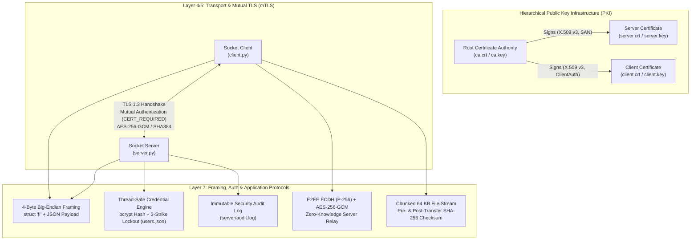
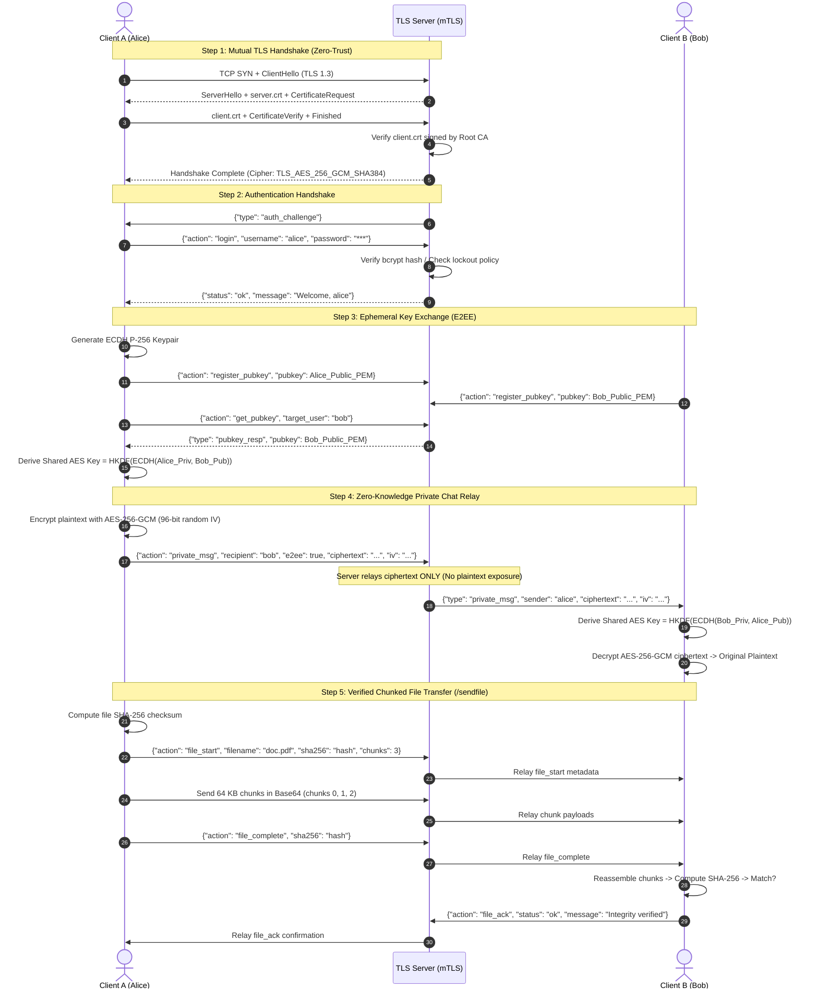

# Secure Client-Server Communication Using Socket Programming & TLS

[](https://www.python.org/)
[](#security-architecture--specifications)
[](#-test-suite--quality-assurance)
[](https://github.com/Textualize/rich)
[](LICENSE)

A production-grade, defense-ready secure client-server socket communication system developed in Python for **Cryptography & Network Security (CNS)**.

The system implements a **Zero-Trust Network Architecture** with **Mutual TLS (mTLS / TLSv1.3)**, a custom hierarchical **Public Key Infrastructure (PKI)**, salted **bcrypt** password hashing, **brute-force account lockout** defense, **length-prefixed binary framing**, **chunked file transfer with SHA-256 integrity verification**, and **End-to-End Encrypted (E2EE)** direct messaging via ephemeral **ECDH (NIST P-256) + HKDF + AES-256-GCM**.

---

## 📋 Table of Contents

- [Overview & Architecture](#-overview--architecture)
- [Key Features](#-key-features)
- [Tech Stack](#-tech-stack)
- [Project Structure](#-project-structure)
- [Installation & Setup](#-installation--setup)
- [Public Key Infrastructure (PKI) & Certificates](#-public-key-infrastructure-pki--certificates)
- [Configuration](#-configuration)
- [Running the Application](#-running-the-application)
- [Command Reference & Usage](#-command-reference--usage)
- [Test Suite & Quality Assurance](#-test-suite--quality-assurance)
- [Security Architecture & Specifications](#-security-architecture--specifications)
- [Defense & Viva Examination Guide](#-defense--viva-examination-guide)
  - [Demo 1: Wireshark Packet Sniffing (Proof of TLS Encryption)](#demo-1-wireshark-packet-sniffing-proof-of-tls-encryption)
  - [Demo 2: Brute-Force Lockout Defense & Audit Trail](#demo-2-brute-force-lockout-defense--audit-trail)
  - [Demo 3: Secure Chunked File Transfer & Tamper Resistance](#demo-3-secure-chunked-file-transfer--tamper-resistance)
  - [Demo 4: End-to-End Encrypted (E2EE) Direct Messaging](#demo-4-end-to-end-encrypted-e2ee-direct-messaging)
  - [Viva Theoretical Questions & Answers](#viva-theoretical-questions--answers)
- [License](#-license)

---

## 🏛️ Overview & Architecture

The application enforces a multi-tier security model:



### Protocol Flow: Handshake to Secure Communication



---

## ✨ Key Features

- **Mutual TLS (mTLS) Enforcement**: Both server and clients authenticate each other. Sockets without a valid client certificate signed by the Root CA are abruptly rejected at the TLS layer (`ssl.CERT_REQUIRED`).
- **Hierarchical PKI Generation**: Includes a standalone utility (`generate_certs.py`) that generates the Root CA (`ca.crt`/`ca.key`), Server Certificate (`server.crt`/`server.key`), and Client Certificate (`client.crt`/`client.key`) with RSA-2048 and X.509 v3 extensions.
- **Length-Prefixed Binary Framing**: Custom 4-byte big-endian framing (`struct.Struct("!I")`) guarantees deterministic packet boundaries and completely prevents TCP stream fragmentation or message coalescing issues.
- **Cryptographic Password Security**: Passwords are salted with 12-round `bcrypt` hashing before storage. Passwords are typed via `getpass` to defeat shoulder-surfing.
- **Brute-Force Account Protection**: Automatically enforces an account lockout for 5 minutes after 3 consecutive failed login attempts. Locks persist across server restarts.
- **End-to-End Encryption (E2EE)**: Private direct messages use ephemeral Elliptic Curve Diffie-Hellman (ECDH NIST P-256) key agreement with HKDF-SHA256 key derivation and AES-256-GCM authenticated encryption. The server acts strictly as a zero-knowledge ciphertext relay.
- **Secure Chunked File Transfer (`/sendfile`)**: Streams large binary files in 64 KB blocks. Automatically hashes files with SHA-256 before transmission and recalculates the hash on the receiver to guarantee bit-level integrity.
- **Real-Time Online User Roster (`/users`)**: Instant query of authenticated active users in the room.
- **Security Audit Trail (`server/audit.log`)**: Immutable structured audit logs tracking connection origins, TLS cipher suites, authentication successes/failures, brute-force lockouts, and message routing.
- **Rich Terminal UI**: Beautiful ANSI terminal formatting with styled panels, masked passwords, real-time message streams, and tables using `rich`.

---

## 💻 Tech Stack

| Component | Technology | Purpose |
| :--- | :--- | :--- |
| **Language** | Python 3.10+ (PEP 484 & PEP 257) | Core runtime with strict type hints |
| **Transport Layer** | `socket`, `ssl` | TCP socket programming with TLSv1.3 wrapper |
| **PKI & Cryptography** | `cryptography` | RSA 2048, X.509 v3, ECDH P-256, HKDF, AES-256-GCM |
| **Password Hashing** | `bcrypt` (12 rounds) | Adaptive Blowfish-based salted key derivation |
| **Integrity Hashing** | `hashlib` (SHA-256) | File and byte chunk verification |
| **Framing & Wire Protocol**| `struct`, `json`, `base64` | 4-byte header encoding and structured serialization |
| **Terminal Experience** | `rich` | Terminal rendering, panels, tables, and logging |
| **Configuration** | `python-dotenv` | Centralized `.env` parameter loading |
| **Test Framework** | `pytest` (v8+) | Automated unit, regression, and integration testing |

---

## 📁 Project Structure

```text
secure-socket-comm/
├── client/
│   ├── __init__.py           # Client package marker
│   ├── client.py             # Interactive CLI/TUI client with rich terminal interface
│   └── gui_client.py         # Modern Desktop GUI Client (Tkinter/TTK dark theme)
├── common/
│   ├── __init__.py           # Shared package marker
│   ├── config.py             # Strongly typed settings loader with .env support
│   └── utils.py              # Framing, crypto helpers (ECDH/AES-GCM/SHA-256), logger
├── server/
│   ├── __init__.py           # Server package marker
│   ├── server.py             # Multithreaded mTLS socket server & message relay
│   ├── auth.py               # Thread-safe user registration, bcrypt & brute-force lockout
│   ├── audit.log             # Security audit log (auto-generated, excluded from git)
│   ├── users.json            # Persistent user database (auto-generated, excluded from git)
│   └── certs/                # PKI credentials directory (excluded from git)
│       ├── .gitkeep          # Tracks directory in version control
│       ├── ca.crt            # Root CA Certificate (Self-Signed)
│       ├── ca.key            # Root CA Private Key (2048-bit RSA)
│       ├── server.crt        # Server Certificate (Signed by Root CA)
│       ├── server.key        # Server Private Key (2048-bit RSA)
│       ├── client.crt        # Client Certificate (Signed by Root CA)
│       └── client.key        # Client Private Key (2048-bit RSA)
├── received_files/           # Default save directory for incoming files (auto-generated)
├── tests/
│   ├── __init__.py           # Tests package marker
│   ├── test_auth.py          # Unit tests: bcrypt, registration, 3-strike lockout
│   ├── test_framing.py       # Unit tests: 4-byte binary framing & fragmentation
│   ├── test_file_transfer.py # Unit tests: 64 KB chunking, SHA-256 & bit-tampering
│   └── test_integration.py  # End-to-end integration tests (mTLS, chat, E2EE, file transfer)
├── .env                      # Local runtime environment file (active)
├── .env.example              # Template configuration file
├── .gitignore                # Git ignore rules for keys, bytecode & databases
├── generate_certs.py         # Full 3-tier PKI certificate generator
├── pytest.ini                # Pytest configuration
├── requirements.txt          # Python dependencies
└── README.md                 # Project documentation & Viva Demo Guide
```

---

## ⚙️ Installation & Setup

### 1. Prerequisites
- Python 3.10 or higher installed (`python --version`).
- Virtual environment tool (`venv`).

### 2. Navigate to Project
```bash
cd secure-socket-comm
```

### 3. Create and Activate Virtual Environment
```bash
# Windows (PowerShell)
python -m venv .venv
.venv\Scripts\Activate.ps1

# Linux / macOS
python3 -m venv .venv
source .venv/bin/activate
```

### 4. Install Dependencies
```bash
pip install -r requirements.txt
```

---

## 🔐 Public Key Infrastructure (PKI) & Certificates

The system uses a complete 3-tier Public Key Infrastructure (PKI) to implement Mutual TLS (mTLS):

1. **Root Certificate Authority (CA)**: Acts as the trust anchor. Issues self-signed certificate `ca.crt`.
2. **Server Certificate**: Signed by Root CA with Subject Alternative Names (SAN) for `localhost` and `127.0.0.1`.
3. **Client Certificate**: Signed by Root CA with `ClientAuth` Extended Key Usage (EKU) for mTLS.

To generate the complete certificate hierarchy:

```bash
python generate_certs.py
```

**Generated Assets in `server/certs/`:**
- `ca.key` & `ca.crt`: Root CA credentials (2048-bit RSA, 10-year validity).
- `server.key` & `server.crt`: Server credentials (2048-bit RSA, signed by CA, 365 days).
- `client.key` & `client.crt`: Client credentials (2048-bit RSA, signed by CA, 365 days).

> [!NOTE]
> All private keys (`*.key`) are automatically excluded by `.gitignore` to prevent credential exposure in source control.

---

## ⚙️ Configuration

The project reads settings from `.env`. A default configuration file is provided. To customize settings, update `.env`:

```ini
# Networking & Server Binding
HOST=127.0.0.1
PORT=8443
MAX_CLIENTS=5
BUFFER_SIZE=4096
AUTH_TIMEOUT=120.0

# Public Key Infrastructure (PKI) & Mutual TLS (mTLS)
CA_FILE=server/certs/ca.crt
CERT_FILE=server/certs/server.crt
KEY_FILE=server/certs/server.key
CLIENT_CERT_FILE=server/certs/client.crt
CLIENT_KEY_FILE=server/certs/client.key
REQUIRE_CLIENT_CERT=true

# File Transfer Parameters
CHUNK_SIZE=65536
RECEIVED_FILES_DIR=received_files
```

---

## 🚀 Running the Application

### Step 1: Start the Secure TLS Server
In your first terminal, run:

```bash
python server/server.py
```

The server displays an informational configuration panel and begins listening for Mutual TLS connections:
```text
╭───────────────────── Secure TLS Socket Server Running ─────────────────────╮
│  Binding Address     127.0.0.1:8443                                        │
│  TLS Certificate     .../server/certs/server.crt                           │
│  Mutual TLS (mTLS)   REQUIRED                                              │
│  Root CA Bundle      .../server/certs/ca.crt                               │
│  Max Backlog         5                                                     │
│  Auth Timeout        120.0s                                                │
│  TLS Minimum         TLSv1.2 (TLSv1.3 Preferred)                           │
╰────────────────────── Press Ctrl+C to stop the server ─────────────────────╯
```

### Step 2: Start Client Instances

You can launch clients using either the **Modern Desktop GUI** or the **Rich Terminal (CLI)**:

#### Option A: Desktop Graphical Interface (GUI)
```bash
python client/gui_client.py
```
*Opens a modern dark-themed desktop window featuring real-time chat, clickable online user roster, interactive file picker with progress bar, and a live Security Telemetry Inspector.*

#### Option B: Rich Terminal Interface (TUI / CLI)
```bash
python client/client.py
```
*Runs an interactive terminal session with styled panels, masked password inputs, and slash commands.*

---

## 💬 Command Reference & Usage

Once logged in, clients can send public messages by typing directly into the prompt, or use built-in slash commands:

| Command | Syntax | Description |
| :--- | :--- | :--- |
| **Public Chat** | `<text>` | Broadcasts plaintext message to all authenticated clients in the room. |
| **Online Users** | `/users` | Displays a table of all currently authenticated connected users. |
| **Private Message** | `/msg <user> <message>` | Transmits an End-to-End Encrypted (E2EE) private message directly to `<user>`. |
| **Secure File Transfer** | `/sendfile <user> <path>` | Transmits a file in 64 KB chunks with SHA-256 integrity verification. |
| **Clear Screen** | `/clear` | Clears terminal history and redisplays session information. |
| **Help Menu** | `/help` | Displays available commands and syntax details. |
| **Disconnect** | `/quit` | Sends termination signal and cleanly closes the TLS socket session. |

### Example Walkthrough

```text
╭─────────────── Secure Encrypted Chat Session ────────────────╮
│ Logged in as: alice                                          │
│ Server: 127.0.0.1:8443                                       │
│ Security: Mutual TLS (mTLS) + E2EE (ECDH P-256 + AES-GCM)   │
╰──────────────────────────────────────────────────────────────╯
[19:00:01] [SYSTEM] >>> 'bob' has joined the secure chat.
[19:00:10] alice: Hello room! Testing broadcast over TLS.
[19:00:15] bob: Hello Alice! Message received securely.

alice> /users
╭──────────── Active Online Users (2) ────────────╮
│ Username          Status                        │
├─────────────────────────────────────────────────┤
│ alice (You)       Authenticated (mTLS)          │
│ bob               Authenticated (mTLS)          │
╰─────────────────────────────────────────────────╯

alice> /msg bob The exam question on Diffie-Hellman was tricky!
[19:00:30] [E2EE Direct Message to bob] The exam question on Diffie-Hellman was tricky!

alice> /sendfile bob notes.pdf
[19:00:45] [FILE] Starting transfer of 'notes.pdf' (143,360 bytes, 3 chunks)...
[19:00:45] [FILE] Sending chunks: [████████████████████████████████] 100%
[19:00:46] [FILE-ACK] File transfer confirmed by bob: Integrity verified (SHA-256 match).
```

---

## 🧪 Test Suite & Quality Assurance

The codebase includes an extensive automated test suite built with `pytest`.

To run the complete test suite:

```bash
python -m pytest tests/
```

### Test Suite Breakdown

```text
tests/
├── test_auth.py (20 tests)
│   ├── bcrypt hash verification and randomized salt uniqueness
│   ├── Empty / invalid / short password validation
│   ├── Case-insensitive username uniqueness (e.g. Alice == alice)
│   ├── Brute-force 3-strikes lockout trigger (5 minute lock)
│   ├── Lockout state queries and access rejection during lockout
│   ├── Failed attempts reset upon successful login
│   └── Automatic expired lockout clearance
│
├── test_framing.py (11 tests)
│   ├── 4-byte big-endian header packing & unpacking (!I)
│   ├── Bidirectional transmission over socketpair
│   ├── TCP stream fragmentation handling (exact byte reassembly)
│   ├── Maximum message threshold enforcement (MAX_MESSAGE_SIZE = 10 MB)
│   ├── Clean EOF disconnection detection
│   └── Premature socket closure handling (ConnectionResetError)
│
├── test_file_transfer.py (12 tests)
│   ├── SHA-256 hashing for arbitrary byte streams (NIST vectors)
│   ├── Incremental file SHA-256 computation in 64 KB blocks
│   ├── Chunking, Base64 serialization, and byte-for-byte reassembly
│   ├── Bit-tampering detection via SHA-256 mismatch
│   ├── Truncated transfer / missing chunk detection
│   └── Path traversal prevention (directory traversal attacks blocked)
│
└── test_integration.py (3 tests)
    ├── Mutual TLS rejection: Client without cert rejected by server
    ├── Mutual TLS acceptance: Client with valid CA cert accepted
    └── Complete communication lifecycle:
        ├── Alice & Bob mTLS connection & registration
        ├── Online user roster retrieval (/users)
        ├── Public broadcast chat
        ├── End-to-End Encryption (E2EE) key exchange & ciphertext relay
        ├── Chunked file transfer (64 KB blocks) & SHA-256 verification
        ├── Delivery acknowledgment (file_ack)
        └── Security audit trail verification (audit.log)
```

**Result: 46 passed in ~8 seconds (100% pass rate).**

---

## 🛡️ Security Architecture & Specifications

### 1. Transport Layer Security & Mutual TLS (mTLS)
- **Protocol**: Negotiates **TLSv1.3** as preferred protocol, with fallback to TLSv1.2. Broken protocols (SSLv2, SSLv3, TLS 1.0, TLS 1.1) are explicitly disabled.
- **Cipher Suite**: Modern Authenticated Encryption with Associated Data (AEAD) cipher: `TLS_AES_256_GCM_SHA384`.
- **Mutual Authentication**: Server requires client certificate verification (`ssl.CERT_REQUIRED`). Untrusted clients cannot complete the handshake.

### 2. Length-Prefixed Binary Framing
TCP is a byte-stream protocol with no intrinsic message boundaries. Without framing, messages can arrive fragmented or concatenated (sticky packets). This application prefixes every payload with a 4-byte big-endian unsigned integer:
$$\text{Wire Format: } [\text{Length (4 bytes: } \texttt{!I}\text{)}] + [\text{UTF-8 JSON Payload}]$$
This guarantees that the receiver reconstructs whole messages regardless of network packet fragmentation.

### 3. Password Security & Brute-Force Lockout
- **Password Hashing**: `bcrypt` uses an adaptive salt (12 rounds), which requires significant computational work to evaluate, rendering GPU-accelerated rainbow table and dictionary attacks impractical.
- **Lockout Policy**: After **3 consecutive failed login attempts**, the account is locked for **300 seconds (5 minutes)**. The lockout timestamp is persisted in `users.json`, ensuring locks cannot be bypassed by restarting the client or server.

### 4. End-to-End Encryption (E2EE)
For private direct messages (`/msg`), the system uses an ephemeral zero-knowledge key agreement protocol:
1. Each client generates an ephemeral **NIST P-256 (SECP256R1)** elliptic curve keypair upon launch.
2. Clients publish public keys to the server and fetch the target recipient's public key.
3. Both clients derive an identical 256-bit symmetric session key using **Elliptic Curve Diffie-Hellman (ECDH)** passed through **HKDF-SHA256**:
   $$K = \text{HKDF}(\text{ECDH}(d_A, Q_B), \text{len}=32, \text{info}=\text{"secure-socket-e2ee-session"})$$
4. Messages are encrypted with **AES-256-GCM** using a random 96-bit Initialization Vector (IV).
5. The server relays **only the ciphertext and IV**; the server has zero access to the plaintext.

### 5. Chunked File Transfer & SHA-256 Verification
Files are transmitted in 64 KB blocks. Prior to transfer, the sender computes the overall SHA-256 digest:
$$\text{Digest} = \text{SHA-256}(\text{File Bytes})$$
The receiver streams chunks into a destination file in `received_files/` and verifies the computed checksum against the sender's metadata. If even a single bit was corrupted during transit, the transfer is rejected.

---

## 🎓 Defense & Viva Examination Guide

This section is designed to help you ace your project defense and practical viva presentation.

---

### Demo 1: Wireshark Packet Sniffing (Proof of TLS Encryption)

**Objective**: Prove to the external examiner that data transmitted over the socket is completely encrypted and immune to eavesdropping.

#### Step-by-Step Procedure:
1. Open **Wireshark**.
2. Select your loopback interface:
   - On Windows: select **Npcap Loopback Adapter** or **Adapter for loopback traffic capture**.
3. Set the capture filter toolbar to:
   ```text
   tcp.port == 8443
   ```
4. Click the blue shark fin icon to start packet capture.
5. In your terminal, run `python server/server.py` and `python client/client.py`.
6. Log in and send a test message: `SecretExamPassword123` or `Classified Project Data`.
7. Stop the Wireshark capture.

#### What to Show the Examiner in Wireshark:
1. **TCP Three-Way Handshake**: Show the `SYN`, `SYN-ACK`, and `ACK` packets on port 8443.
2. **TLS 1.3 Handshake**:
   - Point out the `Client Hello` packet.
   - Point out the `Server Hello` packet with negotiated cipher `TLS_AES_256_GCM_SHA384`.
   - Point out the `Certificate` exchange proving Mutual TLS.
3. **Application Data Frames**:
   - Click on any packet labeled **Application Data Protocol: Hypertext Transfer Protocol or TLS**.
   - Show the bottom packet bytes pane: The entire payload consists of pseudorandom encrypted ciphertext.
   - Right-click the packet $\rightarrow$ **Follow** $\rightarrow$ **TCP Stream**.
   - **Crucial Defense Point**: Point out that neither the username, password, chat message, nor file contents appear in plaintext anywhere in the TCP stream!

---

### Demo 2: Brute-Force Lockout Defense & Audit Trail

**Objective**: Demonstrate automated protection against credential stuffing and brute-force attacks.

#### Step-by-Step Procedure:
1. Start the server (`python server/server.py`) and client (`python client/client.py`).
2. Register a user `testuser` with password `password123`.
3. In another client instance, attempt to log in as `testuser` with wrong passwords:
   - **Attempt 1**: Enter `wrong1` $\rightarrow$ System warns: `2 attempt(s) remaining before account lockout`.
   - **Attempt 2**: Enter `wrong2` $\rightarrow$ System warns: `1 attempt(s) remaining before account lockout`.
   - **Attempt 3**: Enter `wrong3` $\rightarrow$ System triggers lockout: `Account is locked for 5 minutes`.
4. Now, enter the **correct** password (`password123`):
   - Notice that authentication is **blocked**: `Account 'testuser' is locked due to 3 consecutive failed attempts. Try again in 4m 58s`.
5. Open `server/audit.log` and show the examiner the recorded entries:
   ```text
   [2026-11-13 19:28:32 UTC] [AUDIT] [EVENT: AUTH_FAILED    ] [USER: testuser] Invalid password (2 attempts left)
   [2026-11-13 19:28:35 UTC] [AUDIT] [EVENT: AUTH_FAILED    ] [USER: testuser] Invalid password (1 attempts left)
   [2026-11-13 19:28:38 UTC] [AUDIT] [EVENT: AUTH_LOCKOUT   ] [USER: testuser] Account locked for 300 seconds
   ```

---

### Demo 3: Secure Chunked File Transfer & Tamper Resistance

**Objective**: Demonstrate verified binary file streaming, reassembly, and hash checking.

#### Step-by-Step Procedure:
1. Connect two clients (`alice` and `bob`).
2. Create a test file:
   ```bash
   # In terminal or PowerShell:
   "Cryptography and Network Security 7th Sem Defense Report" | Out-File -FilePath demo.txt
   ```
3. Alice transfers the file to Bob:
   ```text
   alice> /sendfile bob demo.txt
   ```
4. Show Bob's terminal:
   - Notice the incoming transfer notification with SHA-256 checksum.
   - The file is saved in `received_files/demo.txt`.
   - Bob's client automatically verifies the SHA-256 hash and sends a `file_ack`.
5. Verify integrity: Open PowerShell and run:
   ```powershell
   Get-FileHash demo.txt -Algorithm SHA256
   Get-FileHash received_files/demo.txt -Algorithm SHA256
   ```
   Both SHA-256 hashes match character-for-character!

---

### Demo 4: End-to-End Encrypted (E2EE) Direct Messaging

**Objective**: Prove zero-knowledge encryption where the server only relays ciphertext.

#### Step-by-Step Procedure:
1. Alice sends a private message to Bob:
   ```text
   alice> /msg bob Confidential E2EE Message
   ```
2. Check the server console log:
   - The server displays: `[DIRECT_MSG] alice -> bob (E2EE Encrypted Payload)`.
   - The server does **not** print or log the message text.
3. Check Bob's terminal:
   - Bob's client uses the derived ECDH shared key to decrypt the AES-GCM ciphertext and displays the decrypted message in cyan.

---

### Viva Theoretical Questions & Answers

#### Q1: Why do we need TLS if we are already using TCP?
> **Answer**: TCP only provides reliable transport (sequencing, flow control, retransmission). It provides **zero confidentiality, integrity, or authentication**. Any intermediary on the network route can inspect packets in plaintext (sniffing) or modify them (man-in-the-middle). TLS adds an encryption and authentication layer directly on top of TCP.

#### Q2: What is Mutual TLS (mTLS) and how does it differ from standard HTTPS/TLS?
> **Answer**: In standard TLS (one-way TLS), only the server presents a certificate to prove its identity to the client (like regular web browsing). The client remains unauthenticated at the transport layer. In **Mutual TLS (mTLS)**, both the server and the client must present X.509 certificates signed by a trusted Root CA. If a client attempts to connect without a valid certificate, the server abruptly terminates the TLS handshake before any application data can be sent.

#### Q3: Why use bcrypt instead of SHA-256 or MD5 for password storage?
> **Answer**: SHA-256 and MD5 are cryptographic hash functions designed to be **fast**. Modern GPUs can compute billions of SHA-256 hashes per second, making brute-force and dictionary attacks easy. In contrast, `bcrypt` is a **key derivation function based on Blowfish** with an adjustable cost factor ($2^{\text{cost}}$ iterations). It is deliberately slow and includes an automatic 128-bit randomized salt, defeating rainbow table lookups and brute-force hardware acceleration.

#### Q4: Why is length-prefixed framing necessary over TCP sockets?
> **Answer**: TCP is a stream-oriented protocol, not a message-oriented protocol. There are no packet boundaries at the application level. If a sender transmits two messages in quick succession, TCP may coalesce them into a single packet (sticky packets), or split one large message across multiple segments. By prefixing every message with a 4-byte unsigned integer indicating the exact payload length, the receiver always knows exactly how many bytes to read before deserializing.

#### Q5: How does End-to-End Encryption (E2EE) work in your project?
> **Answer**: We use the **Diffie-Hellman key exchange over elliptic curves (ECDH)** using the NIST P-256 curve. When two clients chat privately, they exchange public keys through the server. Each client multiplies the other's public point by their own private scalar to compute the identical shared secret point ($S = d_A \cdot Q_B = d_B \cdot Q_A$). We pass this secret through HKDF-SHA256 to derive a 256-bit AES key. Messages are encrypted with AES-256-GCM. Because the server only relays the ciphertext and IV and never possesses the private keys, the server cannot decrypt the messages.

#### Q6: Why did you choose AES-GCM over AES-CBC?
> **Answer**: AES-GCM (Galois/Counter Mode) is an **Authenticated Encryption with Associated Data (AEAD)** mode. It provides both **confidentiality** and **integrity authentication** simultaneously via a GMAC authentication tag. Modes like AES-CBC only provide confidentiality and are vulnerable to padding oracle attacks unless paired with a separate HMAC (Encrypt-then-MAC). GCM is also parallelizable and faster.

---

## 📄 License

Developed for educational and academic assessment purposes for the 7th Semester B.Tech/B.E. Cryptography & Network Security (CNS) curriculum under the MIT License.
